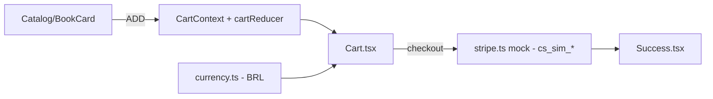

# loja-ebooks-kodaros

**English** · [Português (Brasil)](README.md)

     

## What it is

**The KODAROS e-book store**: a **React 18 + TypeScript + Tailwind SPA** with a **catalog**, **cart** (reducer + context) and **checkout with a simulated Stripe** (built-in mock, no API key). It is the storefront for the KODAROS technical e-books brand.

## Status

A working store prototype, tested (13 tests: cart + checkout) with a confirmed production build (~50 kB gzip).

## Features

- **Catalog** (`lib/books.ts`, `components/Catalog.tsx`, `BookCard.tsx`): the published e-books with cover and price.
- **Cart** (`lib/cart.ts`, `contexts/CartContext.tsx`, `components/Cart.tsx`): a reducer with `ADD`/`REMOVE`/`SET_QUANTITY` actions; quantity 0 removes the item.
- **Currency** (`lib/currency.ts`): BRL price formatting.
- **Checkout** (`components/Checkout.tsx`, `lib/stripe.ts`): creates a payment session via a **simulated Stripe client** (`cs_sim_*`) — no network, no key; in production, swap in `new Stripe(process.env.STRIPE_SECRET_KEY)`.
- **Success** (`Success.tsx`): post-payment screen.

## Architecture

A React SPA (Vite). Cart state lives in a `CartContext` with `useReducer`; the cart/currency logic is pure (testable without a DOM); Stripe is a local mock in `lib/stripe.ts`.



## Stack

- React 18.3, TypeScript ~5.6, Tailwind CSS 3.4
- Vite 5.4 (build/dev), Vitest 2.1 (tests)
- No runtime dependencies beyond React (Stripe is a mock)

## Repository layout

```
loja-ebooks-kodaros/
├── src/
│   ├── lib/          # books, cart, currency, stripe (mock)
│   ├── components/   # Catalog, BookCard, Cart, Checkout, Success, Navbar
│   ├── contexts/CartContext.tsx
│   └── types.ts · App.tsx · main.tsx
├── tests/ (cart · checkout)
├── index.html · tailwind.config.js · vite.config.ts
└── package.json
```

## Prerequisites and installation

Node.js ≥ 18.

```bash
npm install
```

## How to run

```bash
npm run dev        # dev server
npm run build      # production build (tsc + vite)
npm run preview    # serve the build
```

## Tests and quality

Real commands (verified by the agent):

```bash
npm test
# Test Files  2 passed (2) · Tests  13 passed (13)

npm run build
# ✓ built in ~2s (bundle ~158 kB, ~50 kB gzip)
```

## Technical decisions and trade-offs

- **Simulated Stripe (mock)**: the store runs end to end with no keys and no network; switching to the real Stripe is a one-line change.
- **Reducer + Context** for the cart: predictable, independently testable state.
- **Tailwind**: fast styling without a bespoke design system.

## Known limitations and roadmap

- Simulated payment — it does not process real payments.
- No e-book delivery/download after purchase (simulated flow).
- The catalog is fixed in `lib/books.ts`.

## Development process

An individual project by Kelvin Oliveira, built with orchestrated AI agents and reviewed by the author. KODAROS is the author's e-books brand.

## License and author

MIT — Copyright (c) 2026 Kelvin Oliveira.

**Author**: [Kelvin Oliveira](https://github.com/KelvinOliveiraCode) · [Portfolio](https://kelvinoliveiracode.github.io/portfolio/)
