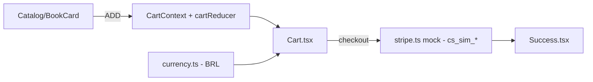

# loja-ebooks-kodaros

[English](README.en.md) · **Português (Brasil)**

     

## O que é

**Loja de e-books da KODAROS**: uma **SPA em React 18 + TypeScript + Tailwind** com **catálogo**, **carrinho** (reducer + context) e **checkout com Stripe simulado** (mock embutido, sem chave de API). Projeto vitrine da marca KODAROS de e-books técnicos.

## Status

Protótipo funcional de loja, testado (13 testes: carrinho + checkout) e com build de produção confirmado (~50 kB gzip).

## Funcionalidades

- **Catálogo** (`lib/books.ts`, `components/Catalog.tsx`, `BookCard.tsx`): os e-books publicados com capa e preço.
- **Carrinho** (`lib/cart.ts`, `contexts/CartContext.tsx`, `components/Cart.tsx`): reducer com ações `ADD`/`REMOVE`/`SET_QUANTITY`; quantidade 0 remove o item.
- **Moeda** (`lib/currency.ts`): formatação de preço em BRL.
- **Checkout** (`components/Checkout.tsx`, `lib/stripe.ts`): cria uma sessão de pagamento via **cliente Stripe simulado** (`cs_sim_*`) — sem rede nem chave; em produção, trocar por `new Stripe(process.env.STRIPE_SECRET_KEY)`.
- **Sucesso** (`Success.tsx`): tela pós-pagamento.

## Arquitetura

SPA React (Vite). O estado do carrinho vive num `CartContext` com `useReducer`; a lógica de carrinho/moeda é pura (testável sem DOM); o Stripe é um mock local em `lib/stripe.ts`.



## Stack

- React 18.3, TypeScript ~5.6, Tailwind CSS 3.4
- Vite 5.4 (build/dev), Vitest 2.1 (testes)
- Sem dependências de runtime além de React (o Stripe é mock)

## Estrutura do repositório

```
loja-ebooks-kodaros/
├── src/
│   ├── lib/          # books, cart, currency, stripe (mock)
│   ├── components/   # Catalog, BookCard, Cart, Checkout, Success, Navbar
│   ├── contexts/CartContext.tsx
│   └── types.ts · App.tsx · main.tsx
├── tests/ (cart · checkout)
├── index.html · tailwind.config.js · vite.config.ts
└── package.json
```

## Pré-requisitos e instalação

Node.js ≥ 18.

```bash
npm install
```

## Como executar

```bash
npm run dev        # dev server
npm run build      # build de produção (tsc + vite)
npm run preview    # serve o build
```

## Testes e qualidade

Comandos reais (verificados pelo agente):

```bash
npm test
# Test Files  2 passed (2) · Tests  13 passed (13)

npm run build
# ✓ built in ~2s (bundle ~158 kB, ~50 kB gzip)
```

## Decisões técnicas e trade-offs

- **Stripe simulado (mock)**: a loja funciona ponta a ponta sem chaves nem rede; trocar pelo Stripe real é uma linha.
- **Reducer + Context** para o carrinho: estado previsível e testável isoladamente.
- **Tailwind**: estilização rápida sem design system próprio.

## Limitações conhecidas e roadmap

- Pagamento simulado — não processa pagamentos reais.
- Sem entrega/download dos e-books pós-compra (fluxo simulado).
- Catálogo fixo em `lib/books.ts`.

## Processo de desenvolvimento

Projeto individual de Kelvin Oliveira, construído com agentes de IA orquestrados e revisado pelo autor. A KODAROS é a marca de e-books do autor.

## Licença e autor

MIT — Copyright (c) 2026 Kelvin Oliveira.

**Autor**: [Kelvin Oliveira](https://github.com/KelvinOliveiraCode) · [Portfólio](https://kelvinoliveiracode.github.io/portfolio/)
